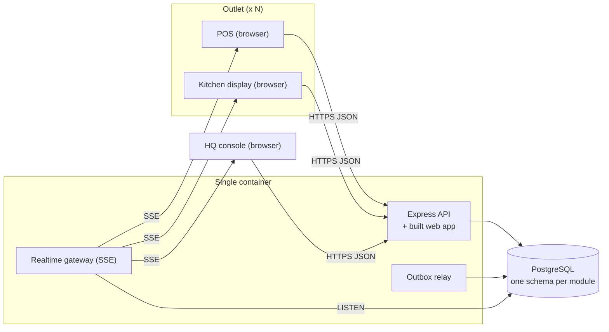
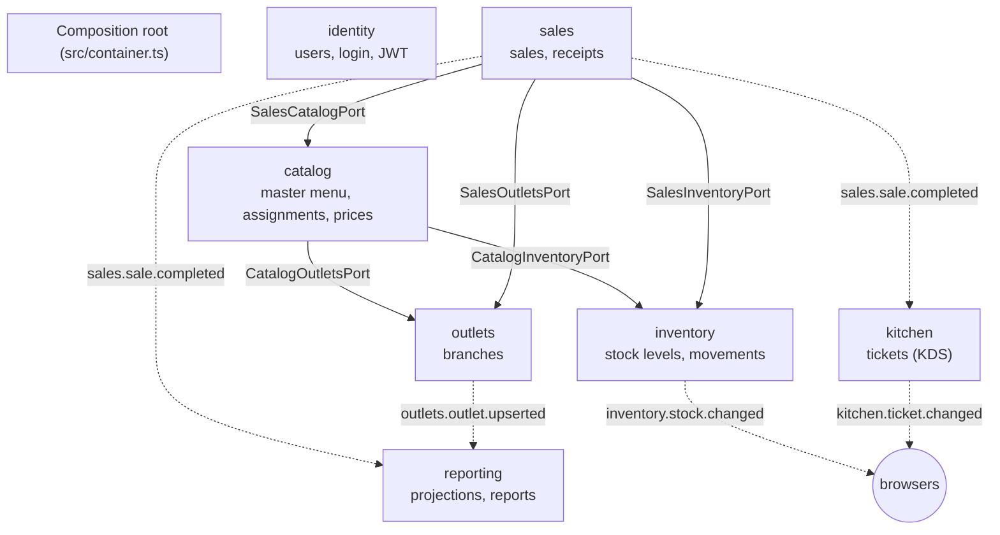
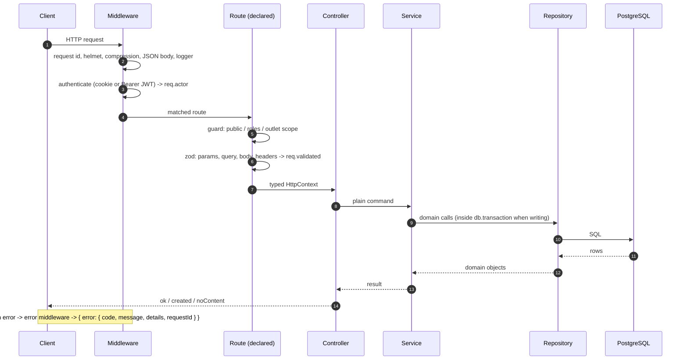
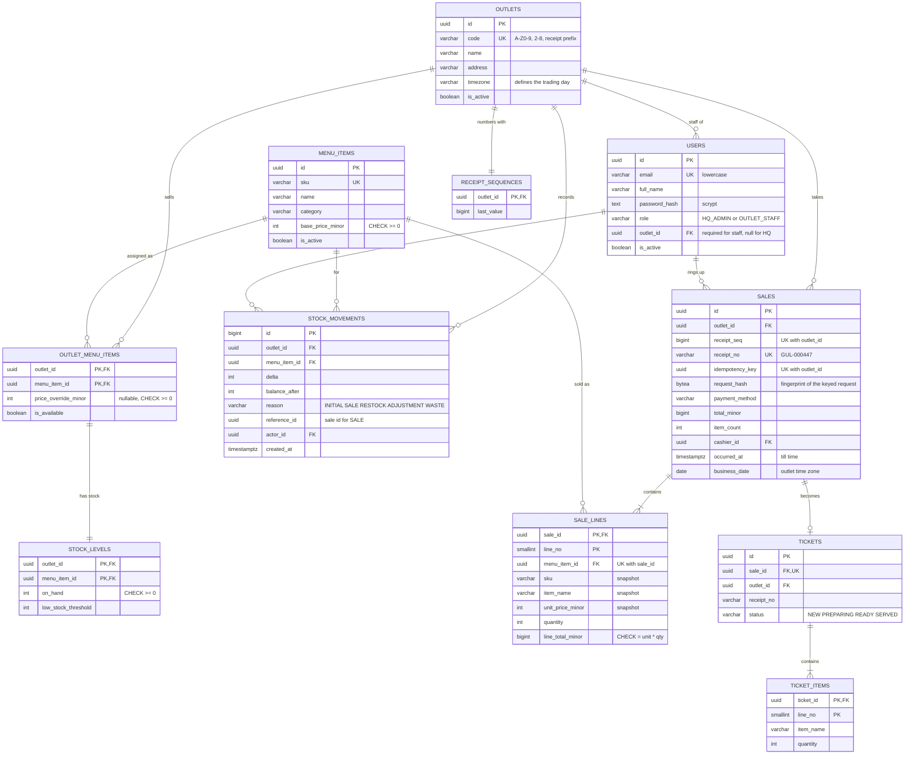
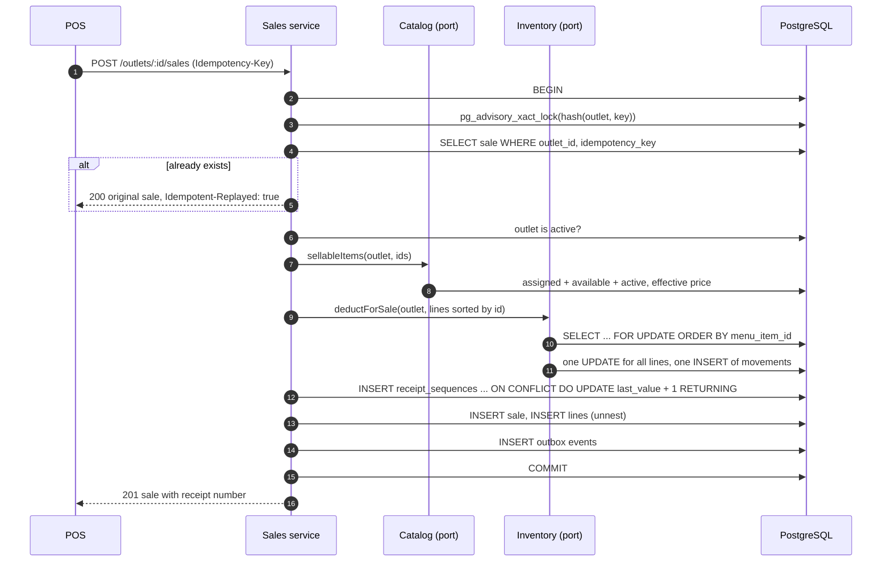
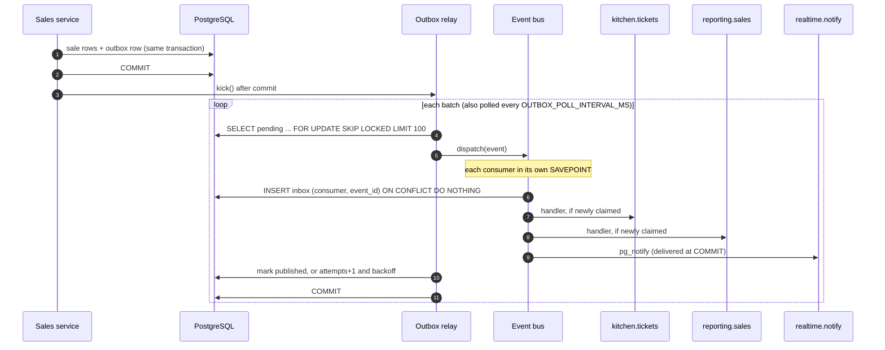
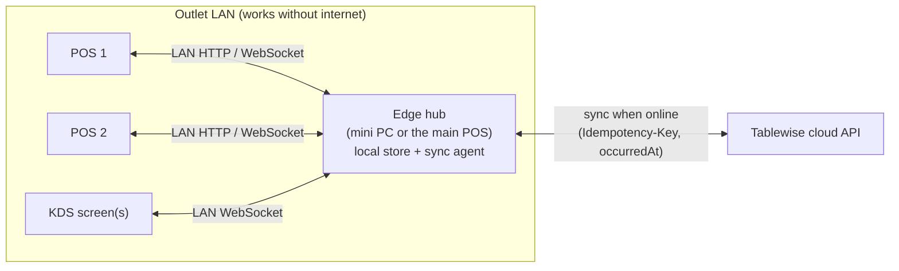

# Tablewise HQ architecture

This document explains how the system is built, why it is built that way, and how it grows: to 10 outlets and 100,000 transactions per month, into microservices, and into outlets that keep trading when the internet goes down.

Short decision records with alternatives live in [adr/](adr/).

## Contents

1. [Goals and constraints](#goals-and-constraints)
2. [System context](#system-context)
3. [Modular monolith](#modular-monolith)
4. [Request lifecycle and layers](#request-lifecycle-and-layers)
5. [Entity relationship diagram](#entity-relationship-diagram)
6. [Sale transaction and concurrency](#sale-transaction-and-concurrency)
7. [Events: outbox, relay, inbox](#events-outbox-relay-inbox)
8. [Reporting](#reporting)
9. [Realtime](#realtime)
10. [Security](#security)
11. [Scaling plan: 10 outlets, 100,000 transactions per month](#scaling-plan-10-outlets-100000-transactions-per-month)
12. [From modular monolith to microservices](#from-modular-monolith-to-microservices)
13. [Offline POS and KDS strategy](#offline-pos-and-kds-strategy)

---

## Goals and constraints

| Goal                      | What it means in practice                                                                                               |
| ------------------------- | ----------------------------------------------------------------------------------------------------------------------- |
| Correct money and stock   | No overselling, no negative stock, no double charges on retry, receipts numbered without gaps or duplicates per outlet. |
| Correct under concurrency | The above must hold when many tills submit at the same moment, on many API instances.                                   |
| Simple to run             | One container and one PostgreSQL database are enough for the target load.                                               |
| Ready to split            | Every module can become its own service without rewriting its callers.                                                  |
| Honest reports            | Reports reflect committed sales only, in each outlet's own trading day.                                                 |

The brief fixes the stack (PostgreSQL, Express, Node.js, React). Everything else follows from the goals above.

---

## System context

The API, outbox relay and realtime gateway run in one Node.js process. Several copies can run side by side: the relay uses `FOR UPDATE SKIP LOCKED` so instances never deliver the same event twice concurrently, and realtime fans out through PostgreSQL `LISTEN/NOTIFY` so a browser connected to any instance sees every event.

---

## Modular monolith

Solid arrows are synchronous calls through ports; dotted arrows are integration events through the outbox.

### Rules

1. **One module, one schema.** A module's repository is the only code that touches its schema. Cross-schema foreign keys (for example `sales.sales.outlet_id -> outlets.outlets.id`) are kept while all modules share one database, because they give integrity for free; they are the first thing dropped when a module moves to its own database, and the port call that already validates the reference takes over.
2. **No module imports another module.** A service that needs another module declares a port (a TypeScript interface) next to itself. `src/container.ts` is the only file that knows every module and plugs each module's public `api` object into the ports that need it. ESLint (`no-restricted-imports`) fails the build on a violation.
3. **Platform is business-agnostic.** `src/platform` (database, HTTP, auth, events, realtime) never imports a module.
4. **Contracts are shared, implementations are not.** Request schemas, response types, error codes and event payloads live in `packages/contracts` so the API and the web app compile against the same definitions.
5. **Synchronous calls only where the answer is needed now.** A sale must know the price and must deduct stock inside its transaction, so those are port calls. Everything that can happen after commit (tickets, reports, live updates) is an event.

### Why a modular monolith

The target load fits easily on one process and one database, and a single transaction is the simplest way to make a sale atomic across catalog, inventory and sales. Microservices would replace that transaction with a saga, add network failure modes and require separate deployments, all for no benefit at this scale. The module rules above keep the seams clean so the split can happen when there is a reason (see [ADR 0001](adr/0001-modular-monolith.md)).

---

## Request lifecycle and layers

| Layer      | Responsibility                                                                                  | Must not                                 |
| ---------- | ----------------------------------------------------------------------------------------------- | ---------------------------------------- |
| Route      | Method, path, access rule, zod schemas, OpenAPI summary. Declared as data with `route({...})`.  | Contain logic.                           |
| Controller | Translate the validated HTTP context into a service call and the result into a response.        | Contain business rules or SQL.           |
| Service    | Business rules, transaction boundaries, calls to other modules through ports, event publishing. | Know about HTTP or write SQL.            |
| Repository | SQL for one schema; map rows to typed objects.                                                  | Contain business rules or call services. |

**Routes as data.** One declaration produces the Express handler, the guard, validation, the controller's types and the OpenAPI 3.1 document served at `/api/openapi.json`. Documentation cannot drift from behaviour because it is generated from the same object (see [ADR 0004](adr/0004-contracts-and-declarative-routes.md)).

**Errors.** Services throw typed errors (`NotFoundError`, `InsufficientStockError`, ...). The error middleware maps them, zod errors, body-parser errors and PostgreSQL constraint violations (by constraint name) into one response shape with a stable `code`. Unknown errors become `INTERNAL` with the details only in the log.

**Ambient transactions.** `Database.transaction(fn)` checks out a client, runs `BEGIN`, and stores the client in `AsyncLocalStorage`. Every `db.query()` made during `fn`, from any repository, uses that client. A nested `transaction()` joins the outer one; `savepoint()` opens a nested scope that can fail alone; `afterCommit()` schedules work for after `COMMIT`. This is what lets the sales service call the catalog and inventory modules inside its own transaction without threading a client through every signature (see [ADR 0002](adr/0002-postgres-raw-sql-ambient-transactions.md)).

---

## Entity relationship diagram

Reporting and platform tables are deliberately outside this diagram: they hold no foreign keys.

| Table                          | Key                                        | Fed by                               |
| ------------------------------ | ------------------------------------------ | ------------------------------------ |
| `reporting.outlet_directory`   | `outlet_id`                                | `outlets.outlet.upserted`            |
| `reporting.daily_outlet_sales` | `(outlet_id, business_date)`               | `sales.sale.completed`               |
| `reporting.daily_item_sales`   | `(outlet_id, business_date, menu_item_id)` | `sales.sale.completed`               |
| `platform.outbox_events`       | `id`; partial index on unpublished rows    | every module, inside its transaction |
| `platform.inbox`               | `(consumer, event_id)`                     | the event bus, once per consumer     |
| `platform.schema_migrations`   | `version`, with checksum                   | the migrator                         |

### Modelling decisions

- **Money is an integer in minor units** (`12550` = BDT 125.50). Floating point cannot represent most decimal amounts exactly; integer sums are exact. Sale totals are `bigint` so a large total can never overflow.
- **Effective price is computed, not stored**: `COALESCE(price_override_minor, base_price_minor)`. Changing the base price updates every outlet that has no override; clearing an override is setting it to `null`.
- **Sale lines snapshot name, SKU and unit price.** Editing or deactivating a menu item never rewrites history or old receipts.
- **Stock exists only for assigned items.** `stock_levels` has a composite foreign key to `outlet_menu_items` with `ON DELETE CASCADE`: unassigning an item removes its stock row, while its movement history stays.
- **Two times per sale.** `occurred_at` is when the till rang it (offline terminals set it when syncing); `business_date` is that instant's date in the outlet's time zone, so a sale at 00:30 local time counts for the right trading day regardless of where the server runs. `created_at` is when the server stored it.
- **Named constraints.** Every unique, check and foreign key constraint has an explicit name so the error middleware can turn a violation into a friendly message with a stable code.

### Index strategy

Each index exists for a specific query.

| Index                                                                                                                    | Serves                                                                                                      |
| ------------------------------------------------------------------------------------------------------------------------ | ----------------------------------------------------------------------------------------------------------- |
| `outlet_menu_items` PK `(outlet_id, menu_item_id)`                                                                       | An outlet's menu (the POS's main read) and the sale's pricing lookup.                                       |
| `outlet_menu_items (menu_item_id)`                                                                                       | "Which outlets sell this item" on the menu item screen.                                                     |
| `menu_items (category, name)`                                                                                            | Menu lists grouped by category.                                                                             |
| `menu_items` GIN trigram on `name \|\| ' ' \|\| sku`                                                                     | "Contains" search in the HQ menu (`ILIKE '%latte%'`), which a B-tree cannot serve.                          |
| `stock_levels` PK `(outlet_id, menu_item_id)`                                                                            | The `FOR UPDATE` lock in every sale; the inventory screen.                                                  |
| `stock_movements (outlet_id, created_at DESC, id DESC)` and `(outlet_id, menu_item_id, created_at DESC, id DESC)`        | The audit trail, all items or one item, newest first, read by keyset.                                       |
| `stock_movements (reference_id)`                                                                                         | "Which stock movements did this sale cause".                                                                |
| `sales (outlet_id, receipt_seq)` unique                                                                                  | Gap-free numbering backstop; receipt lookup.                                                                |
| `sales (outlet_id, idempotency_key)` unique                                                                              | Idempotent replay lookup.                                                                                   |
| `sales (outlet_id, business_date DESC, occurred_at DESC, id DESC)` and `(business_date DESC, occurred_at DESC, id DESC)` | Sales history per outlet and across outlets; the full sort key lets a keyset page start with an index seek. |
| `tickets` partial index on open tickets                                                                                  | The kitchen board reads only open tickets, so the served backlog never slows it.                            |
| `outbox_events` partial index where `published_at IS NULL`                                                               | The relay's scan touches only pending events, however large the table grows.                                |

### Large lists

Only two tables grow without limit, and both are read with keyset pagination: `sales` and `stock_movements`. A page asks for "the next N rows after this one" (`(business_date, occurred_at, id) < (cursor row)` for sales, `(created_at, id)` for movements). PostgreSQL turns that into an index range scan on the indexes above, so page 5,000 costs the same as page 1, and a sale made while someone reads page 1 never shifts page 2. OFFSET pagination would read and throw away every skipped row instead.

Totals are counted with `LIMIT 1001` inside the count, so a list says "1,000+" rather than counting a year of rows on every click. Bare requests are bounded too: the sales list defaults to the last 30 trading days and the audit trail to a 30-day rolling window (7, 30, 90 or 365).

Everything else returned in full is small by nature: outlets, an outlet's menu and stock (bounded by the master menu), today's kitchen tickets (24 hours, at most 200) and reports (pre-aggregated, at most 366 days). The master menu itself is page-numbered (at most 1,000 pages); the HQ assignment screen loads it 50 at a time with "Load more" and filters "not on this outlet" on the server, and the command palette searches it on the server, so no item is ever out of reach. The POS renders the whole outlet menu without virtualisation, which is right for menus of a few hundred items; a menu of thousands would add list virtualisation to the item grid.

---

## Sale transaction and concurrency

### Why each step is safe

| Risk                                     | Protection                                                                                                                                                                                                                                                                                                                                               |
| ---------------------------------------- | -------------------------------------------------------------------------------------------------------------------------------------------------------------------------------------------------------------------------------------------------------------------------------------------------------------------------------------------------------- |
| Two sales take the last unit             | Stock rows are locked with `FOR UPDATE` before checking. The second transaction waits, then re-reads the committed quantity and fails with `INSUFFICIENT_STOCK`. `CHECK (on_hand >= 0)` refuses any code path that forgets.                                                                                                                              |
| Deadlock between multi-item sales        | Lines are merged and sorted by `menu_item_id`, and the lock query uses `ORDER BY menu_item_id`. Every transaction acquires row locks in the same global order, so a cycle cannot form. A test runs 30 parallel sales with opposite line orders.                                                                                                          |
| Duplicate receipt numbers                | The counter row for the outlet is upserted with `last_value + 1 ... RETURNING`. The row lock serialises concurrent increments per outlet. `UNIQUE (outlet_id, receipt_seq)` is the backstop.                                                                                                                                                             |
| Gaps in receipt numbers                  | The increment is part of the sale's transaction. If anything fails, the increment rolls back with it. A PostgreSQL `SEQUENCE` would not work here: sequences are not transactional and leave gaps on rollback.                                                                                                                                           |
| Counter becomes a bottleneck             | The counter is the last lock taken, just before the inserts and commit, so it is held for about a millisecond. Different outlets have different counter rows and never wait for each other.                                                                                                                                                              |
| Double charge on network retry           | `Idempotency-Key` (UUID) per sale attempt. A transaction-scoped advisory lock on `(outlet, key)` makes concurrent retries queue; the first commits, the rest find it and return it. `UNIQUE (outlet_id, idempotency_key)` is the backstop. A request fingerprint stops a reused key from replaying the wrong sale (422). Tested with 8 parallel retries. |
| Partial sale                             | One transaction for everything. Stock, receipt counter, sale, lines and outbox events commit or roll back together.                                                                                                                                                                                                                                      |
| Selling an item the outlet does not have | Catalog returns only items assigned to that outlet, available and active. Missing ones fail the sale with `ITEMS_NOT_SELLABLE` listing every offending id.                                                                                                                                                                                               |
| Price tampering                          | The client sends only item ids and quantities. Prices come from the database inside the transaction.                                                                                                                                                                                                                                                     |
| Backdated or future sales                | `occurredAt` is accepted up to 72 hours in the past (offline sync) and at most 5 minutes in the future (clock skew).                                                                                                                                                                                                                                     |

Isolation level is PostgreSQL's default `READ COMMITTED`. Explicit row locks give exactly the serialisation needed (per stock row, per outlet counter) without the retry storms that `SERIALIZABLE` would cause under contention.

---

## Events: outbox, relay, inbox

- **Atomic with the change.** `outbox.publish()` refuses to run outside a transaction, so an event can only exist if the state change that caused it committed. No "sale saved, event lost" or "event sent, sale rolled back".
- **Low latency without busy polling.** The publishing transaction schedules `relay.kick()` with `afterCommit`, so events are usually delivered within milliseconds. A poll every second (configurable) catches anything a crashed instance left behind.
- **Safe with many instances.** `FOR UPDATE SKIP LOCKED` lets several relays work the same table without blocking or double-delivering.
- **At-least-once delivery, exactly-once effect.** Each subscriber has a consumer name. Before a handler runs, the bus inserts `(consumer, event_id)` into `platform.inbox` in the same transaction as the handler's writes; a redelivered event is skipped. The handler and its inbox row commit together.
- **Failure isolation.** Each consumer runs in its own savepoint. A failing consumer rolls back only its own work; the others keep theirs, so a broken kitchen handler never holds back the revenue projection. The event is retried with exponential backoff (2, 4, 8 ... seconds, capped at 5 minutes) for the failed consumers only, since the inbox skips the rest. `last_error` names each failing consumer. The rest of the batch carries on.
- **Dead letters are visible and recoverable.** After 10 attempts an event is parked and logged at error level, and `/health/ready` reports `parkedEvents` so a monitor can alert on it. Once the cause is fixed, `pnpm db:replay-events [id ...]` (in the image: `node dist/cli/replay-events.js`) re-queues parked events with a fresh attempt budget; replaying is safe because of the inbox.

Events published today:

| Event                     | Producer  | Consumers                                        |
| ------------------------- | --------- | ------------------------------------------------ |
| `outlets.outlet.upserted` | outlets   | `reporting.outlets` (outlet directory), realtime |
| `sales.sale.completed`    | sales     | `kitchen.tickets`, `reporting.sales`, realtime   |
| `inventory.stock.changed` | inventory | realtime                                         |
| `kitchen.ticket.changed`  | kitchen   | realtime                                         |

Kitchen only creates tickets for sales that happened in the last 30 minutes (`KITCHEN_WINDOW_MS` in `kitchen.service.ts`), so a backfill of yesterday's offline sales does not flood today's board.

---

## Reporting

Reports read projections, never the sales tables.

- `daily_outlet_sales` holds one row per outlet per trading day: sale count, items sold, revenue.
- `daily_item_sales` holds one row per outlet, day and item: quantity and revenue.
- Both are maintained with `INSERT ... ON CONFLICT DO UPDATE SET x = x + EXCLUDED.x` from `sales.sale.completed`, protected from double counting by the inbox.

| Report                 | Query                                                                                                                                                                                            |
| ---------------------- | ------------------------------------------------------------------------------------------------------------------------------------------------------------------------------------------------ |
| Revenue by outlet      | `outlet_directory LEFT JOIN SUM(daily_outlet_sales) GROUP BY outlet` for the range. Outlets without sales appear with zero. Totals and average ticket are derived.                               |
| Top N items per outlet | `SUM(daily_item_sales) GROUP BY outlet, item`, then `ROW_NUMBER() OVER (PARTITION BY outlet_id ORDER BY quantity DESC, revenue DESC, name)` and `WHERE rank <= N`. Ties break deterministically. |
| Revenue trend          | `generate_series` over the date range `LEFT JOIN` the daily rows, so every day has a point, including zero days.                                                                                 |

Why projections:

- **Cost does not grow with history.** A 30-day revenue report for 10 outlets reads at most 300 rows whether the month had 1,000 or 1,000,000 sales.
- **No contention with the till.** Reports never scan or lock `sales`, so a heavy report cannot slow down checkout.
- **Portable.** The reporting schema has no foreign keys and is fed only by events, so it can move to a read replica, a separate database or a warehouse without changing the code that writes sales.
- **Eventually consistent, by milliseconds.** The relay is kicked on commit, so a sale normally appears in the projections almost immediately. The live dashboard refreshes when the event arrives.

"Today" defaults are computed in `BUSINESS_TIMEZONE` (default `Asia/Dhaka`), not the server's time zone, which is UTC on most hosts.

---

## Realtime

- The browser opens `GET /api/v1/stream` (Server-Sent Events) with its session cookie.
- The gateway subscribes to the realtime event types on the bus as consumer `realtime.notify`. Delivering an event runs `pg_notify('tablewise_realtime', json)` inside the relay's transaction, so the notification is only sent if delivery commits.
- Every API instance holds one dedicated connection that `LISTEN`s on that channel (reconnecting with backoff if it drops) and writes each event to its own SSE clients, **filtered by `canAccessOutlet`**: outlet staff only receive their own outlet's events, HQ receives everything.
- A heartbeat comment every 25 seconds keeps proxies from closing idle streams; `retry: 3000` tells the browser how fast to reconnect. Compression is disabled for this route so events are not buffered.
- PostgreSQL limits a notification payload to 8,000 bytes. An unusually large sale event is sent without its lines (the browser refetches details on demand).

Why SSE and `LISTEN/NOTIFY` rather than WebSockets and Redis: the traffic is one-way (server to browser), SSE works over plain HTTP with automatic reconnect, and PostgreSQL already provides cross-instance pub/sub, so no extra infrastructure is needed (see [ADR 0005](adr/0005-realtime-sse-listen-notify.md)).

---

## Security

| Concern         | Measure                                                                                                                                                                                                                                                                                                                                                                                                                                                                                               |
| --------------- | ----------------------------------------------------------------------------------------------------------------------------------------------------------------------------------------------------------------------------------------------------------------------------------------------------------------------------------------------------------------------------------------------------------------------------------------------------------------------------------------------------- |
| Authentication  | HS256 JWT (issuer `tablewise-api`, audience `tablewise`) in an httpOnly, SameSite=Lax cookie; `Secure` in production. Bearer tokens accepted for API clients. Every request also checks the stored user (active, same role, same outlet), so deactivating or moving someone ends their access at once rather than at token expiry.                                                                                                                                                                    |
| Authorization   | Every route declares `public`, `roles` and/or an outlet parameter. The guard runs before validation. Outlet staff are confined to their own outlet; services re-check scope on reads by id (another outlet's sale or ticket is a 404, not a 403, so ids cannot be probed). Ids are lowercased on input, matching how PostgreSQL compares UUIDs.                                                                                                                                                       |
| Passwords       | `scrypt` (N=16384, r=8, p=1) with per-hash salt and parameters; constant-time comparison; a dummy hash for unknown emails so response time does not reveal which emails exist; one generic error message.                                                                                                                                                                                                                                                                                             |
| Brute force     | 10 failed logins per IP per 5 minutes.                                                                                                                                                                                                                                                                                                                                                                                                                                                                |
| CSRF            | SameSite=Lax cookie, and every state-changing request with a body must be `application/json`, which a cross-site form cannot send.                                                                                                                                                                                                                                                                                                                                                                    |
| Input           | zod validation on params, query, body and headers; 100 KB body limit; parameterised SQL only.                                                                                                                                                                                                                                                                                                                                                                                                         |
| Headers         | `helmet` with a strict CSP (`script-src 'self'`) for the web app; a separate CSP only for the API docs page.                                                                                                                                                                                                                                                                                                                                                                                          |
| Secrets in logs | pino redacts `authorization`, `cookie`, `set-cookie` and password fields.                                                                                                                                                                                                                                                                                                                                                                                                                             |
| Stock changes   | Outlet staff may restock, adjust and write off their own outlet's stock, because deliveries and waste happen at the outlet and waiting for HQ would stop the till. The control is visibility, not prevention: every change is an append-only movement with who, when, why and the resulting balance, and the database refuses negative stock. If a business needs approval, the place for it is a threshold rule in the inventory service (for example, adjustments above N units go to an HQ queue). |
| Database TLS    | `DATABASE_SSL=true` verifies the server certificate against Node's CA bundle (no `rejectUnauthorized: false`).                                                                                                                                                                                                                                                                                                                                                                                        |
| Configuration   | All environment variables validated at boot; `JWT_SECRET` must be at least 32 characters; `db:reset` refuses to run in production.                                                                                                                                                                                                                                                                                                                                                                    |

---

## Scaling plan: 10 outlets, 100,000 transactions per month

### Load model

| Quantity                              | Value                               |
| ------------------------------------- | ----------------------------------- |
| Transactions per month                | 100,000                             |
| Per day (30 days)                     | about 3,330                         |
| Per outlet per day                    | about 333                           |
| Average over a 12-hour trading day    | about 280 per hour, 0.08 per second |
| Busiest hour (assume 3x average)      | about 830 per hour, 0.25 per second |
| Lunch-rush burst (assume 10x average) | about 0.8 per second, all outlets   |
| Per outlet at burst                   | about one sale every 12 seconds     |

### Cost per sale

A three-line sale performs roughly 12 statements in one transaction: advisory lock, idempotency lookup, outlet check, pricing read, stock lock, one stock `UPDATE`, one movement `INSERT`, counter upsert, sale `INSERT`, lines `INSERT`, outbox `INSERT` (4 rows), `COMMIT`. On a small managed PostgreSQL this takes a few milliseconds. The per-outlet serialisation point (the counter row) is held for about a millisecond, so a single outlet could sustain hundreds of sales per second before the counter mattered. The design has two orders of magnitude of headroom at the target load.

### Storage growth

| Data per sale (3 lines)                     | Approximate size with indexes |
| ------------------------------------------- | ----------------------------- |
| `sales` row                                 | 0.4 KB                        |
| 3 `sale_lines`                              | 0.5 KB                        |
| 3 `stock_movements`                         | 0.5 KB                        |
| Kitchen ticket and items                    | 0.4 KB                        |
| 4 outbox events (JSON) + about 8 inbox rows | 2 KB                          |
| **Total**                                   | **about 4 KB**                |

100,000 sales a month is about 400 MB a month, roughly half of it outbox and inbox rows that are only needed for a few days. Projections are tiny: `daily_outlet_sales` grows by 3,650 rows a year for 10 outlets, `daily_item_sales` by about 180,000 rows a year with 50 items per outlet.

### Plan, in the order it would be needed

1. **Now (target load): one API instance, one PostgreSQL.** Default pool of 10 connections per instance. Health checks (`/health/live`, `/health/ready`) for the platform's restarts and zero-downtime deploys.
2. **Housekeeping (first months).** A daily job deletes published outbox events and inbox rows older than 7 days, keeping those tables at a few hundred MB. Dead letters (attempts at the limit) are alerted on and kept until resolved.
3. **High availability.** Two or more API instances behind the load balancer; nothing in the process is instance-local except SSE connections, which reconnect anywhere. Managed PostgreSQL with a standby and point-in-time recovery. Migrations already take an advisory lock, so instances can boot together.
4. **Connection pooling.** When instances x pool size approaches PostgreSQL's connection limit, put PgBouncer in transaction mode in front of the database. The realtime `LISTEN` connection must stay a direct session connection (it is one dedicated client per instance, already separate from the pool).
5. **Partitioning (a few million rows).** Range-partition `sales`, `sale_lines` and `stock_movements` by month. Recent partitions stay hot and small, old ones can be detached and archived, and date-range queries prune partitions. Unique constraints then include the partition key, so `UNIQUE (outlet_id, receipt_seq)` would move to a small per-outlet lookup table or be enforced by the counter alone.
6. **Read scaling.** Point reporting reads and the HQ sales history at a read replica (a second `Database` instance wired in `container.ts`). Reporting already reads only its own projection tables, which tolerate replica lag of seconds.
7. **Analytics.** For ad-hoc questions (hourly heatmaps, basket analysis, margin) stream the outbox events into a warehouse (BigQuery, ClickHouse or Postgres with columnar storage) rather than querying the operational database.
8. **Observability.** Request-id-correlated JSON logs are already in place. Add metrics (request latency by route, sale transaction time, lock wait time, outbox lag = `now() - min(occurred_at)` of pending events, dead-letter count, SSE client count) and OpenTelemetry traces across the relay. Alert on outbox lag and dead letters first: they are the early signal of a broken consumer.
9. **Caching, only if measured.** Outlet menus change rarely and are read by every till; an HTTP `ETag` on `GET /outlets/:id/menu` or a short in-process cache invalidated by catalog events would remove most of that read load.

### Infrastructure

| Stage      | Layout                                                                                                                                                                                                                 |
| ---------- | ---------------------------------------------------------------------------------------------------------------------------------------------------------------------------------------------------------------------- |
| Demo (now) | Render web service running the Docker image (API + built web app), Neon serverless PostgreSQL.                                                                                                                         |
| Production | 2+ instances across zones, managed PostgreSQL with a standby, automated backups and PITR, secrets in the platform's secret store, CI running the full `pnpm check` with a real PostgreSQL service before every deploy. |
| Larger     | Web app on a CDN, API behind a load balancer, PgBouncer, a read replica for reporting, a warehouse fed from events, services extracted as below.                                                                       |

---

## From modular monolith to microservices

Each module already behaves like a service inside the process: it owns its schema, exposes a small `api` object, receives other modules only through ports, and talks asynchronously through events with idempotent consumers. Extraction is therefore mechanical.

### Steps to extract one module

1. **Copy the module and the platform** into a new service with its own `container.ts`, routes and database. Its routes move unchanged (they are declared data).
2. **Move its schema** into the new database (`pg_dump --schema`), and drop the cross-schema foreign keys that pointed at it. References are validated by the port call that already happens before the write.
3. **Replace the in-process `api`** in the monolith's `container.ts` with an HTTP (or gRPC) client implementing the same port interface. Callers do not change, because they only ever knew the interface.
4. **Move events onto a broker.** The relay keeps reading the same outbox, but publishes to a broker (NATS JetStream, RabbitMQ, Kafka or SNS/SQS) instead of the in-process bus. Consumers keep their inbox table, which already gives exactly-once effects on an at-least-once broker.
5. **Route traffic** at an API gateway by path prefix (`/api/v1/reports/*` -> reporting). JWTs are already verifiable anywhere with the shared key (or switch to an asymmetric key and JWKS so only identity can sign).

### Extraction order

| Order | Service           | Why this order                                                                                                                          |
| ----- | ----------------- | --------------------------------------------------------------------------------------------------------------------------------------- |
| 1     | Reporting         | Read-only, fed entirely by events, no foreign keys, no synchronous callers. Zero risk; the biggest win for read scaling.                |
| 2     | Kitchen           | Fed by events, small API, its own UI. Can run close to the kitchens (see offline strategy).                                             |
| 3     | Identity          | Stateless token verification is already everywhere. Extract to sign tokens with an asymmetric key and add SSO later.                    |
| 4     | Catalog + Outlets | Master data. Changes rarely, read often: publish full snapshots as events and let consumers cache them.                                 |
| 5     | Sales + Inventory | Last, and probably together. A sale needs price and stock in the same transaction today. Split only when necessary, using reservations. |

### When sales and inventory separate

The single transaction becomes a short saga:

1. Sales asks Inventory to **reserve** stock for the lines (Inventory locks, checks and creates a reservation with an expiry, idempotent on the sale id).
2. Sales commits the sale with its receipt number.
3. Sales emits `sales.sale.completed`; Inventory **confirms** the reservation into a deduction.
4. If the sale fails, Sales emits `sales.sale.aborted` (or the reservation expires) and Inventory releases it.

Receipt numbering stays inside Sales, so gap-free numbering per outlet is unaffected. Stock can never go negative because reservations are checked against `on_hand - reserved`.

---

## Offline POS and KDS strategy

Outlets must keep selling and cooking when the internet drops. The design builds on two properties the API already has: **idempotent sale submission** (`Idempotency-Key`) and **client-supplied sale time** (`occurredAt`, accepted up to 72 hours back).

### Topology

An **edge hub** runs inside each outlet: a small always-on device (or the main POS terminal) with a local database (SQLite or embedded PostgreSQL) and a sync agent. Tills and kitchen screens talk to the hub over the local network, so they keep working together when the internet is gone. Without a hub, each POS can still work alone with IndexedDB in the browser, but then tills and kitchen screens cannot see each other's orders offline.

### What each side owns

| Data                      | Source of truth                             | Offline behaviour                                                                                                                                                                |
| ------------------------- | ------------------------------------------- | -------------------------------------------------------------------------------------------------------------------------------------------------------------------------------- |
| Menu, prices, assignments | Cloud (HQ)                                  | Hub caches the outlet's menu (`GET /outlets/:id/menu`) and refreshes it on reconnect and on catalog events. Tills sell from the cache.                                           |
| Stock                     | Cloud                                       | Hub keeps a local copy and decrements it as sales happen, warning (or blocking, per outlet policy) when an item runs out locally.                                                |
| Sales                     | Created at the edge, confirmed by the cloud | Each sale gets a UUID `Idempotency-Key` and `occurredAt` when rung up, and is written to the hub's queue before the receipt prints.                                              |
| Receipt numbers           | Cloud for official numbers                  | Offline receipts carry a provisional number per terminal, such as `GUL-T2-0042`. The official `GUL-000447` is assigned when the sale syncs and is shown in history and reprints. |
| Kitchen tickets           | Hub while offline                           | The hub creates the ticket immediately and pushes it to KDS screens over the LAN. Bump/recall actions are recorded locally with timestamps.                                      |

### Sync protocol

1. **Write-ahead queue.** A sale goes into the hub's durable queue (and to the KDS) before anything else. A power cut after printing never loses a sale.
2. **Replay in order.** When the internet returns, the sync agent submits queued sales oldest first to `POST /outlets/:id/sales` with the original `Idempotency-Key` and `occurredAt`. A sale that was sent but whose response was lost is simply returned again (`Idempotent-Replayed: true`), even if it is now older than the 72-hour backdating window, so retries are always safe.
3. **Record the official receipt.** The response's `receiptNo` is stored against the provisional number.
4. **Stock conflicts.** If the cloud rejects a sale with `INSUFFICIENT_STOCK` (another channel sold the stock, or the local copy was wrong), the food has already been served, so the sale must not be lost. The agent parks it in a "needs review" list; the manager either records a stock correction (`ADJUSTMENT` or `RESTOCK` with a note) and retries, or writes it off. Nothing is silently dropped, and the audit trail shows why stock changed.
5. **Menu conflicts.** `ITEMS_NOT_SELLABLE` (HQ removed the item while the outlet was offline) goes to the same review list. A production version would accept such sales at the snapshotted price with a flag, since the outlet acted in good faith.
6. **Kitchen events up.** Ticket status changes made offline are replayed after their sale has synced; the cloud's state machine (`NEW -> PREPARING -> READY -> SERVED`) accepts them in timestamp order.
7. **Backfilled sales stay out of today's KDS.** The cloud only creates kitchen tickets for sales from the last 30 minutes, so a burst of replayed sales after a long outage does not flood the cloud-connected boards; those orders were already cooked from the hub's local tickets.
8. **Reports catch up automatically.** Each synced sale carries its own `occurredAt`, so it lands in the correct trading day's projection even if it syncs the next morning.

### Why provisional numbers instead of reserving receipt blocks

An alternative is to reserve a block of official numbers per terminal (for example 1000 to 1099) while online. It gives final numbers offline, but breaks the requirement that receipts are sequential per outlet without gaps: unused numbers in a block become gaps, and two terminals' blocks interleave out of time order. Provisional numbers keep the official sequence gap-free and ordered by sync, and the cloud remains the single authority.

### What the current code already provides

| Capability                                 | Status                                                  |
| ------------------------------------------ | ------------------------------------------------------- |
| Idempotent sale submission                 | Implemented and tested                                  |
| Client-supplied sale time with bounds      | Implemented (`occurredAt`, 72 h back, 5 min ahead)      |
| Correct trading day for late sales         | Implemented (`business_date` from the outlet time zone) |
| Kitchen ignores backfilled sales           | Implemented (30-minute window)                          |
| Shortfalls reported per item for review    | Implemented (`INSUFFICIENT_STOCK` details)              |
| Edge hub, local queue, provisional numbers | Designed here, not built                                |
